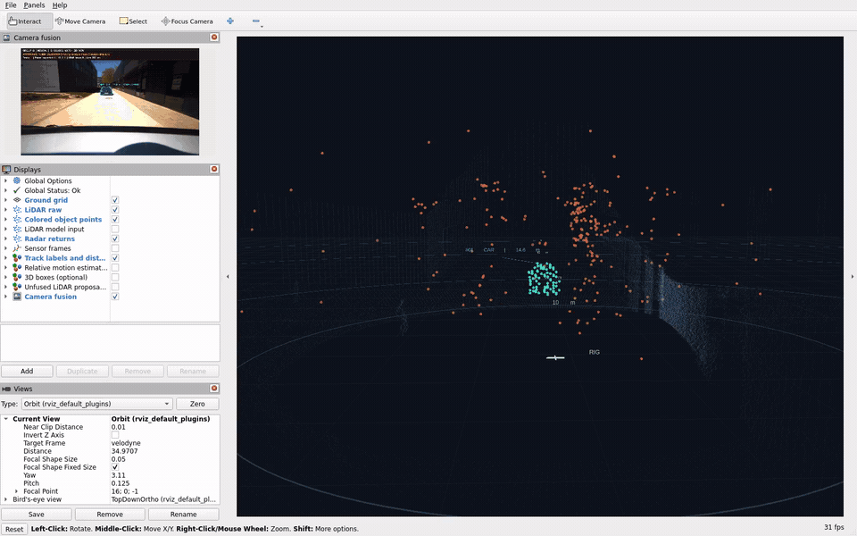
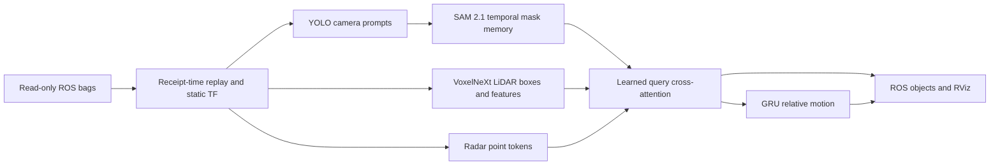

# Group 8 | Learned camera, LiDAR and radar perception

[](https://github.com/kshitijprasaddev/sensor_fusion/actions/workflows/tests.yml)

A ROS 2 research project with **pretrained LiDAR detection, neural temporal mask
tracking and locally trained cross-modal attention**, running on the RTX 4060
inside the requested NVIDIA TensorRT 23.08 container.

The neural profile combines:

- **YOLO11n** for camera proposals and automatic object prompts.
- **VoxelNeXt** for learned 3D LiDAR boxes and sparse features.
- **SAM 2.1 tiny** for visual mask identities through transformer memory.
- **QueryFusion**, our trained attention head, for camera/LiDAR/radar association.
- A trained **GRU motion head** for relative XY velocity.

**Research status:** camera intrinsics are approximate and sensor alignment uses
bag receipt times. The custom head learns from explicitly disclosed weak labels,
not annotated ground truth. Execution and teacher agreement do not establish
real detection/tracking accuracy. The stable profile uses hybrid object-query
feature fusion. It is not a reproduced end-to-end BEVFusion or a road-ready
perception system.

A separate **experimental spatial middle-fusion profile** combines dense camera
features, the LiDAR backbone's spatial features and radar rasters before its own
3D detection head. It is distinct from the stable QueryFusion v2 association
profile. Its encoders stay frozen during multi-epoch head training, and its
teacher boxes are pseudo-labels. Read [middle fusion explained](docs/MIDDLE_FUSION.md)
for the architecture, commands, training boundaries and evaluation limits.

**Start here:** [plain-language explanation](docs/START_HERE.md),
[step-by-step terminal commands](docs/RUN_GUIDE.md), and
[v2 improvements and tradeoffs](docs/FUSION_V2.md).

The current display emphasizes **camera masks and colored LiDAR object points**.
Misleading image-space cuboids are off, while 3D boxes and redesigned relative
motion vectors are optional RViz layers. A runtime continuity check withholds
abrupt association jumps. Read [display and robustness changes](docs/DISPLAY_AND_ROBUSTNESS.md).

Read the [literature review](docs/LITERATURE_REVIEW.md),
[architecture and commands](docs/AI_PIPELINE.md), and
[measured neural results](docs/AI_RESULTS.md).

The current default is **QueryFusion v2**: gated camera descriptors, contextual
radar self-attention, descriptor dropout and distributed weak radar supervision.
On the same bag 2 development features, exact LiDAR teacher agreement improved
from 79.9% to 91.0% and exact radar-point agreement from 37.5% to 62.2%.
Motion weak-target error increased from 0.53 to 0.62 m/s. These are disclosed
development diagnostics, not ground-truth accuracy or a state-of-the-art result.



Accelerated excerpt from the actual neural v2 RViz session.
[Full-resolution screenshot](docs/assets/masks-scene-rviz.png).

## Run the neural demo on this workstation

The checkout is `/home/kshitij0/sensor_fusion`. Models and images have already
been prepared locally. Use a graphical Ubuntu terminal:

```bash
sudo systemctl start docker
sudo setfacl -m u:kshitij0:rw /var/run/docker.sock
cd /home/kshitij0/sensor_fusion
./scripts/run.sh ai-demo
```

The helper selects the neural image/configuration and starts at `rate:=0.1` to
leave processing headroom. Replay repeats by default. Stop with Ctrl+C or
`docker stop group8-rviz`. Stop one demo before starting the next.
The launcher uses ROS domain 8 by default; container shells inherit it.

```bash
# Second recorded bag
./scripts/run.sh ai-demo bag:=/data/studentProject1

# Top-down view, after stopping the first demo
./scripts/run.sh ai-birdseye

# One pass
./scripts/run.sh ai-demo loop:=false

# Tests and full neural evaluation on both bags
./scripts/run.sh ai-test
./scripts/run.sh ai-validate
```

To try the experimental middle profile, stop the earlier demo first, then run:

```bash
./scripts/run.sh mid-build
./scripts/run.sh mid-test
./scripts/run.sh mid-demo
```

This uses the same AI image with `fusion_middle.yaml` and separate RViz
preferences. `ai-demo` continues to select v2. See the
[run guide](docs/RUN_GUIDE.md) for `mid-extract`, `mid-train`, evaluation and
runtime checks. Published measurements must be read with their model version;
v2's results below are not results for the new middle detector.

The original data directory is `/home/kshitij0/Downloads/studentProject1`,
containing `studentProject/` and `studentProject1/`. Set `DATA_DIR` if relocated.
Bags are mounted read-only; models and results persist in local folders.

## Build on the tested RTX workstation

Requirements: Linux x86_64, Docker access, NVIDIA driver and Container Toolkit,
the supplied data, and sufficient disk space for the NVIDIA/ROS/CUDA build.
The neural CUDA extensions target compute capability 8.9; other architectures
need a suitable rebuild. This is not a tested Jetson image.

```bash
./scripts/run.sh build
./scripts/run.sh prepare --engine
./scripts/run.sh ai-build
./scripts/run.sh ai-prepare
./scripts/run.sh ai-demo
```

The small trained `models/query_fusion_v2.pt` and preserved v1 head are included
in Git. The published
VoxelNeXt and SAM checkpoints are downloaded with verified hashes. Upstream
model binaries, TensorRT engines, raw bags, feature caches and full videos are
excluded from Git. See [environment details](docs/ENVIRONMENT.md) and
[third-party notices](THIRD_PARTY_NOTICES.md).

## Stable v2 architecture



The neural runtime does not execute DBSCAN, Kalman filtering or Hungarian
assignment. It retains explicit non-learned geometry, ROI filtering, suppression
and confidence/range checks. It requires visible camera instances with accepted
LiDAR associations; it does not track every radar-only or off-camera object.
SAM memory has finite slots and exposes capacity rejections.

## Reproduce v2 training and evaluate

```bash
./scripts/run.sh ai-extract --output /results/ai_features_reproduced
./scripts/run.sh ai-train \
  --features /results/ai_features_reproduced \
  --output /models/query_fusion_reproduced.pt \
  --report /results/ai_training_reproduced.json
./scripts/run.sh ai-evaluate /data/studentProject1 \
  --weights /models/yolo11n.engine \
  --output /results/my_ai_run --video
```

The first 70% of bag 1 trains the fusion/GRU head, followed by a 10% purge gap,
10% checkpoint selection and 10% temperature fitting. Bag 2 is excluded from
training and selection but informed the v2 design through prior v1 inspection;
it is now development data, not an untouched test. Published perception encoders
stay frozen. The recordings are short and related. Full configuration,
loss history, model hashes and weak-target agreement are exported. Model
limitations and feature-ablation regressions are reported without hiding them.

## ROS outputs

| Topic | Contents |
| --- | --- |
| `/fusion/image` | Camera overlay with SAM masks/IDs and matched 3D information |
| `/fusion/nonground` | Neural profile: sampled LiDAR model input, including ground; baseline: ground-filtered points |
| `/fusion/markers` | Compact IDs, range labels and distance guides |
| `/fusion/instance_points` | Real LiDAR returns inside matched detections, colored by ID |
| `/fusion/boxes` | Optional oriented boxes |
| `/fusion/motion` | Optional relative-motion vectors |
| `/fusion/proposals` | Optional unfused LiDAR proposals |
| `/fusion/objects` | `vision_msgs/Detection3DArray` |
| `/fusion/tracks` | IDs, source provenance, positions, relative velocity and heuristic covariance |
| `/fusion/metrics` | Pipeline name, counts, attention summaries, timing and drop counters |

All object positions use the moving `velodyne` sensor frame. No global
localization or validated ego-motion compensation is implemented. In neural
metrics, radar counts mean filtered points, not baseline clusters.

## Classical comparison

The original implementation is preserved for regression tests and comparison:

```bash
./scripts/run.sh demo weights:=/models/yolo11n.engine
./scripts/run.sh evaluate /data/studentProject --modality lidar --output /results/baseline_lidar
```

It uses YOLO11n, LiDAR/radar clustering, geometric association and Kalman tracking.
Its four offline modes are `lidar`, `camera_lidar`, `lidar_radar` and `all`.
These switches are not mislabeled as neural ablations.

[Original baseline report](docs/PROJECT_REPORT.md),
[baseline model inventory](docs/MODELS.md),
[baseline animated recording](docs/assets/rviz-demo.gif).

## Calibration and scientific limits

Recorded extrinsics are available; real rectified camera intrinsics, ground-truth
3D boxes/IDs and validated ego pose are missing. Import real calibration using
the [calibration guide](docs/CALIBRATION.md). For the neural profile, changed
intrinsics also require feature re-extraction and retraining the fusion head;
the checkpoint refuses an incompatible intrinsic matrix.

No mAP, HOTA, AMOTA, absolute road speed or state-of-the-art performance is claimed
on these bags. See the [validation plan](docs/VALIDATION_PLAN.md) for the independent
labels and measurements needed to establish accuracy.

## License

Project source and the custom trained head: AGPL-3.0. Upstream models, NVIDIA
software and datasets retain their own terms. See [LICENSE](LICENSE) and
[third-party notices](THIRD_PARTY_NOTICES.md).
