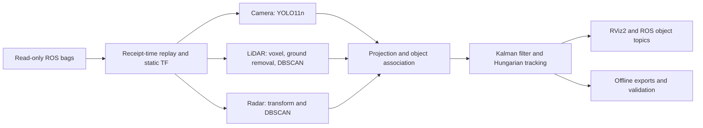

# Group 8 | Multi-sensor perception

Camera, LiDAR and radar object fusion for the THI automated-vehicle project.
Built in the requested NVIDIA TensorRT 23.08 container with ROS 2 Humble,
YOLO11n, geometric point-cloud detection, Kalman tracking and RViz2.

**Calibration status:** the recordings contain sensor extrinsics but no camera
intrinsics. The default projection is clearly marked approximate. Importing the
real calibration later requires a new configuration and a rerun, not code changes.

## Run the project

Requirements: Linux x86_64, Docker access, an NVIDIA driver, NVIDIA Container
Toolkit, about 25 GB free disk for the image/build, and the supplied bag directory.
The helper supports NVIDIA CDI and the registered Docker runtime. See the
[environment notes](docs/ENVIRONMENT.md) for CPU and direct-device fallback modes.

```bash
git clone https://github.com/kshitijprasaddev/sensor_fusion.git
cd sensor_fusion
export DATA_DIR=/home/kshitij0/Downloads/studentProject1

./scripts/run.sh build
./scripts/run.sh prepare --engine
./scripts/run.sh demo weights:=/models/yolo11n.engine
```

RViz opens with the camera overlay, LiDAR, radar, frame tree, fused boxes, track
IDs and relative-velocity arrows. Playback loops at half speed to accommodate
processing and GUI load. Use `rate:=1.0` to test the original rate, and inspect
`/fusion/metrics` for dropped frames. This is a recorded-data demonstrator.

```bash
# Second recording
./scripts/run.sh demo bag:=/data/studentProject1 weights:=/models/yolo11n.engine

# Complete offline runs, with annotated videos and per-frame exports
./scripts/run.sh evaluate /data/studentProject --weights /models/yolo11n.engine --output /results/studentProject --video
./scripts/run.sh evaluate /data/studentProject1 --weights /models/yolo11n.engine --output /results/studentProject1 --video

# Numerical tests and a read-only dataset audit
./scripts/run.sh test
./scripts/run.sh audit
```

The supplied root should contain `studentProject/metadata.yaml` and
`studentProject1/metadata.yaml` beside their `.db3` files. Raw recordings are
mounted read-only. Models, engines, logs and generated videos stay local under
`models` and `results`; they are excluded from Git.

## How it works



The learned model is **YOLO11n**, pretrained on COCO. LiDAR and radar use geometric
detectors. No PointNet++, PointPillars, radar neural network or learned fusion
weights are claimed as implemented. The radar bag already contains detection
points, so raw radar CFAR processing is not part of this pipeline. See the full
[model inventory and literature review](docs/MODELS.md).

| Recorded topic | Role |
| --- | --- |
| `/blackfly_s/cam0/image_rectified` | 1920 x 1200 camera images, about 10 Hz |
| `/velodyne/points_raw` | Organized XYZ/intensity/ring LiDAR cloud, about 10 Hz |
| `/PointCloudDetection` | XYZ, radial velocity, range, RCS and angles, about 20 Hz |
| `/velodyne/imu` | IMU, about 100 Hz; replayed and audited |
| `/tf_static` | Recorded sensor extrinsics |

The first bag contains 3,304 messages over 23.58 s; the second contains 2,294
messages over 16.38 s. LiDAR headers use a device clock while the camera and radar
use Unix-like time. The demo uses bag receipt time for alignment and `/clock`.
This fallback is documented in [calibration and time](docs/CALIBRATION.md).

| Output | Content |
| --- | --- |
| `/fusion/image` | Camera detections, projected points and track labels |
| `/fusion/nonground` | Filtered LiDAR points in `velodyne` |
| `/fusion/markers` | RViz boxes, IDs, source labels and relative-velocity arrows |
| `/fusion/objects` | Standard `vision_msgs/Detection3DArray`, IDs and XY covariance |
| `/fusion/tracks` | JSON states, relative velocities, covariance, source provenance and recorded radial velocity |
| `/fusion/metrics` | Timing, association counts, synchronization deltas and frame losses |

## Replace the camera calibration later

Use the standard YAML exported by ROS `camera_calibration`. For this rectified
image topic the importer reads the rectified projection matrix, validates it,
and creates a new config without overwriting the approximate default.

```bash
./scripts/run.sh calibrate /absolute/path/to/camera.yaml
./scripts/run.sh demo config:=/results/fusion_calibrated.yaml weights:=/models/yolo11n.engine
./scripts/run.sh evaluate /data/studentProject --config /results/fusion_calibrated.yaml --weights /models/yolo11n.engine --output /results/calibrated
```

Check extrinsics and reprojection independently before interpreting accuracy.
See [the calibration guide](docs/CALIBRATION.md) for image size, rectification,
clock offsets and radar velocity conventions.

## Evidence and course handover

* [Project report and measured results](docs/PROJECT_REPORT.md)
* [Dataset audit extracted from both bags](docs/dataset_audit.json)
* [Validation protocol and ablations](docs/VALIDATION_PLAN.md)
* [Environment versions and Jetson differences](docs/ENVIRONMENT.md)
* [Two-week progress report template](docs/PROGRESS_REPORT.md)

There is no ground truth, camera intrinsic calibration or ego pose in the supplied
data. Execution and association counts cannot establish detection accuracy.
Track velocities are relative to the moving sensor, and geometric boxes may
include structures. The report separates measured behavior from these limits.

## Repository layout

```text
src/group8_fusion/    ROS package, shared numerical pipeline, launch and RViz config
scripts/             Container commands, calibration import, evaluation and audit
tests/               Geometry, decoding, association, tracking and calibration tests
docs/                Design decisions, evidence and course handover
models/              Local model cache, ignored by Git
results/             Local runs and videos, ignored by Git
```

License: [AGPL-3.0](LICENSE). See [third-party notices](THIRD_PARTY_NOTICES.md)
for Ultralytics models, NVIDIA container terms and the supplied recordings.
