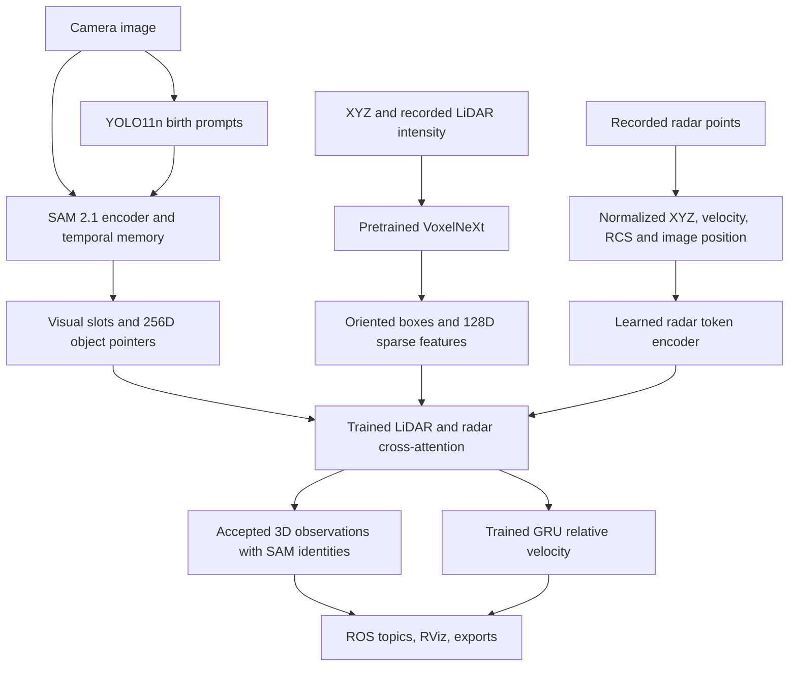

# Neural pipeline: architecture, training and operation

This profile adds learned LiDAR detection, pretrained temporal segmentation,
trained cross-modal association and a trained relative-motion head. It is a
working research prototype with weak supervision. It is not an accuracy-validated
or fully calibrated vehicle perception system.

## What changed

| Stage | Classical baseline | Neural profile |
| --- | --- | --- |
| Camera proposals | YOLO11n | YOLO11n retained as automatic prompts |
| LiDAR objects | RANSAC/DBSCAN clusters | Pretrained VoxelNeXt sparse 3D detector |
| Radar evidence | DBSCAN clusters | Individual XYZ/v/RCS point tokens, learned MLP |
| Cross-modal association | IoU/distance + Hungarian | Trained four-head cross-attention with null tokens |
| Temporal identity | Kalman/Hungarian | SAM 2.1 mask-memory transformer, persistent prompt slots |
| Relative velocity | Constant-velocity Kalman state | Trained 64-state GRU and velocity head |

The neural profile never calls the baseline clustering or assignment routines.
Projection, ROI filtering, birth suppression, confidence/range rejection, NMS and
coordinate transforms remain non-learned operations. Published neural systems
also require preprocessing and output decoding; these are not labeled AI here.

This is **hybrid object-query feature fusion**, not a reproduced end-to-end
BEVFusion/TransFusion model. Published encoders are frozen. Only our compact
fusion/GRU head is trained locally. SAM supplies visual identities, not complete
unprompted 3D tracking. 3D tracks require both a visible SAM instance and an
accepted LiDAR association, so radar-only and off-camera objects are not tracked
by this profile. Full-scene geometric output remains available in the baseline.



## Model and data contracts

- Camera: YOLO11n COCO weights; fixed 640 TensorRT engine for proposals.
- LiDAR: upstream VoxelNeXt nuScenes checkpoint, ten classes, single-sweep input.
  Recorded intensity is divided by 255 and clipped to [0,1]. Time lag is zero.
  No unrecorded sweeps are synthesized. The detector and 128D sparse feature
  lookup use original model weights and preprocessing configuration.
- SAM: Ultralytics 8.4.95 SAM 2.1 tiny implementation, 1024 image input, FP16.
  Top-left letterbox padding is removed before restoring masks to camera size.
  Memory holds at most three frames; eight slots are available per sequence.
  Slots are not silently reused. Capacity-rejected prompt attempts are counted.
- Query vector: SAM pointer (256), normalized image box (4), camera class (6).
- LiDAR token: sparse feature (128), normalized geometry (9), score (1), class
  one-hot (10), projected image box (4), totaling 152.
- Radar token: normalized XYZ (3), recorded v (1), RCS (1), image coordinate (2),
  projection-valid flag (1). Individual points are used without clustering.
  At most 128 are retained in deterministic range order.
- Fusion: dimension 64, four attention heads, explicit no-observation tokens.
  Learned geometry biases complement neural features. Independent selections
  that collide on a box are suppressed by posterior score; no global assignment
  solver is used. A conservative 5 m radar sanity gate remains explicit.
- Motion: 64-dimensional GRU state, fused features and current/previous observed
  positions with elapsed time. Output is relative XY velocity. Initial velocity
  is zero. Fixed reporting covariances are heuristic, not calibrated uncertainty.

Final box centers and extents come from the selected VoxelNeXt observation.
Radar attention supplies association evidence and contributes to fused motion
features; it does not independently refine the 3D box center.

All positions use the moving `velodyne` frame. There is no global localization or
validated ego-motion compensation. Radar velocity is an input attribute whose
physical convention remains undocumented; the raw value is also exported.

## Start on this workstation

The trained head and upstream models have already been prepared locally.

```bash
sudo systemctl start docker
sudo setfacl -m u:kshitij0:rw /var/run/docker.sock
cd /home/kshitij0/sensor_fusion
./scripts/run.sh ai-demo
```

The neural helper selects the AI image/configuration, TensorRT camera engine and
`rate:=0.1`. At one camera frame per wall second this leaves processing headroom.
The initial replay delay remains eight seconds; model setup may take additional
time. It is not a full-speed deployment claim. Stop with Ctrl+C or
`docker stop group8-rviz`. Only start one demo using that container name.

Second bag:

```bash
./scripts/run.sh ai-demo bag:=/data/studentProject1
```

Single pass:

```bash
./scripts/run.sh ai-demo loop:=false
```

Keep the old classical demo as a separate comparison:

```bash
./scripts/run.sh demo weights:=/models/yolo11n.engine
```

The topic names remain compatible. In neural mode `/fusion/nonground` carries a
sampled model-input cloud, including ground; its name is retained for compatibility.
The neural RViz configuration labels it **LiDAR model input**. `radar_objects`
counts individual filtered points, not baseline clusters; metrics expose the unit.

## Build from source

The requested NVIDIA TensorRT 23.08 image remains the ultimate base. The AI image
adds spconv-cu120 2.3.6 and the pinned upstream VoxelNeXt source
`b5b7d393cd1d0ecbbaeaca365b453b488791035d`. Its CUDA extensions target this RTX
4060's compute capability 8.9, with PTX retained. Other GPUs may require a rebuild
with a suitable architecture list. This is an x86 workstation build, not Jetson.

```bash
./scripts/run.sh build
./scripts/run.sh prepare --engine
./scripts/run.sh ai-build
./scripts/run.sh ai-prepare
./scripts/run.sh ai-demo
```

The small locally trained `models/query_fusion.pt` is included in Git. Published
upstream checkpoint binaries and the hardware-specific TensorRT engine are not.
`ai-prepare` verifies upstream SHA-256 values. Model provenance is in
`models/ai_manifest.json` and the trained checkpoint. Docker does not use
privileged mode. `ai-build` preserves the installed base and compiles neural
extensions; it does not silently upgrade the complete CUDA/ROS stack.

## Reproduce feature extraction and training

Use a fresh feature directory to avoid accidentally mixing runs:

```bash
./scripts/run.sh ai-extract --output /results/ai_features_reproduced
./scripts/run.sh ai-train \
  --features /results/ai_features_reproduced \
  --output /models/query_fusion_reproduced.pt \
  --report /results/ai_training_reproduced.json \
  --epochs 100
```

Training does not fine-tune SAM or VoxelNeXt. It trains the 96,968-parameter
fusion/motion head using weak associations. Camera/LiDAR targets come from
compatible-class projected-box overlap; radar targets are nearby points relative
to the selected LiDAR box. Velocity targets are clipped differences of those
weak positions. These assumptions inherit detector and calibration errors.

Training uses frames 0 to 163 of bag 1, purges 164 to 187 and validates on 188 to 234.
Bag 2 is excluded from gradients and checkpoint selection. Validation loss
selects the checkpoint; evaluation reports all queries, positives and null cases
separately. No accuracy claim is inferred from pseudo-label agreement. Temporal
memory is reset between recordings. The two bags share a scene/domain, so this
is a limited sequence holdout.

To deploy a retrained head, copy the AI YAML into `results`, point its
`neural.fusion.weights` to `/models/query_fusion_reproduced.pt`, and pass
`config:=/results/your_config.yaml`. Configuration is explicit; no model is
silently substituted or initialized randomly when a checkpoint is missing.

## Evaluate, test and inspect

```bash
./scripts/run.sh ai-test
./scripts/run.sh ai-validate
./scripts/run.sh ai-evaluate /data/studentProject1 \
  --weights /models/yolo11n.engine \
  --output /results/my_ai_run --video
```

`ai-validate` runs tests, dependency checks, environment capture and full real
inference/video generation on both bags. It does not retrain against the second
bag. The baseline evaluator's four `--modality` ablations are not implemented for
this neural profile; requests for them fail rather than mislabel an experiment.
Neural feature-zeroing diagnostics are in the training report. These are feature
ablations, not complete sensor-removal benchmarks or detection mAP comparisons.

While the live demo is running, from a second host terminal:

```bash
docker exec -it group8-rviz bash
source /opt/ros/humble/setup.bash
source /workspace/sensor_fusion/install/setup.bash
ros2 topic echo /fusion/metrics --once --full-length
ros2 topic echo /fusion/tracks --once --full-length
```

Look for `pipeline: neural`, `visual_tracks`, `sam_capacity_rejections`, attention
statistics and synchronization/drop counters. The same read-only receipt-time
playback and static sensor TF are used. There is still no hardware synchronization.

## Real calibration later

Import real rectified camera calibration using the AI YAML as the base:

```bash
./scripts/run.sh calibrate /absolute/path/camera.yaml \
  --base src/group8_fusion/config/fusion_ai.yaml \
  --output /results/fusion_ai_calibrated.yaml
```

The learned head checks its training intrinsics. Changing calibration requires
feature re-extraction and head retraining with that configuration, not merely
relabeling old weights as calibrated. Use the extractor's `--config` option and
then train against the resulting new feature directory. Also verify extrinsics
and timing on independent targets. The importer does not estimate calibration.

See [literature review](LITERATURE_REVIEW.md) and [measured results](AI_RESULTS.md).
