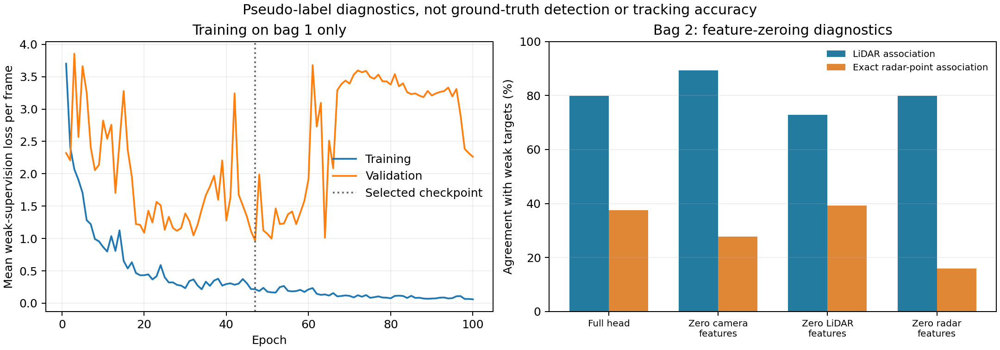
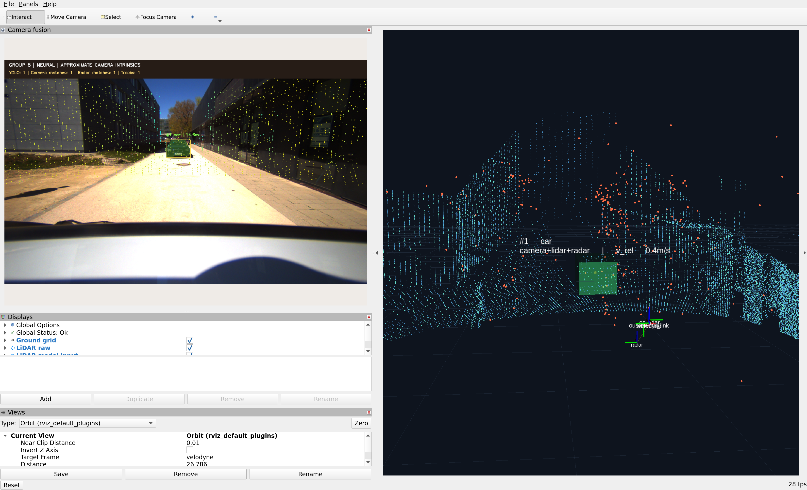

# Neural implementation: measured results

**This page preserves the v1 measurements.** The default neural configuration
now uses v2. Read [v2 comparisons and current runtime evidence](FUSION_V2.md).
For a human-readable introduction, start with [Understand the project](START_HERE.md).

Execution date: 22 October 2026. Hardware: RTX 4060 Laptop GPU, 8 GB.
Environment: requested NVIDIA TensorRT 23.08 base, ROS Humble, PyTorch 2.4,
VoxelNeXt sparse convolutions, SAM 2.1 tiny FP16, YOLO11n TensorRT FP16.

## Scope of evidence

The pretrained encoders were executed on all 397 camera frames across both bags.
The custom attention/GRU head was actually optimized, checkpointed, reloaded and
executed in full offline runs and a live ROS/RViz session. Ground-truth labels,
real camera intrinsics and ego pose remain unavailable. No detection mAP, HOTA,
AMOTA, absolute speed accuracy or state-of-the-art claim is made.

## Learned head

- 96,968 trainable parameters; published perception encoders remain frozen.
- 100 epochs, seed 8; checkpoint selected at epoch 47 by validation loss.
- Train: bag 1 frames 0 to 163. Purge: 164 to 187. Validation: 188 to 234.
- Bag 2 is excluded from gradient updates and checkpoint selection.
- Validation exact weak LiDAR association agreement: 92.6%; exact weak radar
  point agreement: 75.5%. The untrained head gave 1.1% and 0.0% respectively.
- Bag 2: 288 visual queries, including 166 weak positive LiDAR associations.
  Exact LiDAR agreement is 79.9%; positive-only teacher recall is 98.8%.
- Bag 2 exact radar-point agreement is 37.5%, with positive-only teacher recall
  48.8%. Several nearby radar points can compete; this does not establish real
  physical radar association accuracy.
- XY velocity component weak-target MAE is about 0.53 m/s on bag 2. The target itself
  is a clipped difference of weak 3D positions, not measured vehicle speed.

These are **teacher-agreement diagnostics**, including null cases. They are not
percentages of correctly detected real-world objects. Similar scenes and weak
labels make the evaluation limited.

## Feature-zeroing diagnostics on bag 2

| Input to trained head | LiDAR weak-target agreement | Exact radar weak-target agreement |
| --- | ---: | ---: |
| Full head | 79.9% | 37.5% |
| Zero camera features | 89.2% | 27.8% |
| Zero lidar features | 72.9% | 39.2% |
| Zero radar features | 79.9% | 16.0% |

Zeroing camera pointer features improves LiDAR teacher agreement here. This is a
negative result for the current camera feature contribution and suggests
sensitivity/overfitting; it is not hidden. Zeroing radar features reduces exact
radar agreement. These perturbations change features while retaining proposals
and geometry; they are not complete sensor-removal ablations. Gradient tests
verify that all three neural inputs can affect the head, which does not prove
all of them improve perception accuracy.

## Full real-inference runs

| Bag | Camera frames | Median core latency | p95 core latency | Accepted camera/LiDAR observations | Accepted radar-supported observations |
| --- | ---: | ---: | ---: | ---: | ---: |
| studentProject | 235 | 364.1 ms | 385.5 ms | 341 | 315 |
| studentProject1 | 162 | 369.9 ms | 399.5 ms | 177 | 158 |

Counts sum observations over frames, not distinct real objects. Both runs skipped
zero frames for missing LiDAR. Radar counts now mean filtered individual points,
not the baseline's clusters. The neural profile produced two distinct 3D visual
IDs in bag 1 and three in bag 2; this is not an identity correctness metric.

Core latency includes learned detection, association and motion processing;
it excludes decoding, annotation/video encoding and ROS transport. Cold-start
maxima exceed one second. Median throughput is below the original 10 Hz camera
rate, so live playback defaults to 0.1 speed. No real-time-at-full-rate claim is
made. Baseline historical timing is not a controlled paired speed comparison.

Frozen feature extraction's PyTorch peak allocated memory was approximately
1.1 GB. The five-frame runtime guard reported about 933 MiB. This excludes some
non-PyTorch allocations and is not total device memory consumption.

## ROS and implementation checks

- 26 tests passed inside the container: 20 original checks and six neural-head
  checks, covering missing sensors, permutation equivariance, gradient paths,
  recurrent motion, invalid radar values and missing weights.
- Dependency check reported no broken requirements.
- A five-frame GPU guard disabled the classical DBSCAN/ground/association and
  Kalman/Hungarian routines. Neural inference passed with zero forbidden calls.
- A 25-second observer received 25 each of camera overlays, clouds, object arrays,
  markers, track exports and metrics. All required RViz subscriptions were present.
- Live output used `pipeline: neural`, with finite positions and velocities and
  all recorded static sensor frames. The last sampled counters showed zero
  missing-LiDAR and internal image-queue drops. These counters do not measure
  every possible upstream transport loss.

## Failure modes and next experiments

SAM memory has eight slots; bag 2 rejected three new-prompt attempts after slots
were exhausted. These are attempts, not three proven distinct missed objects.
Visual masks can drift or duplicate identity after re-prompting. Camera-visible
instances without an accepted LiDAR box have no exported 3D track. Radar-only and
off-camera objects are not tracked in this neural profile.

Positions and dimensions come from the selected VoxelNeXt box. Radar contributes
association evidence and fused motion features; it does not independently refine
box centers. Learned position-error correction is not claimed. Geometric safety
gates and fixed reporting covariances remain heuristic. Some neural output
confidences are overconfident relative to weak-label errors and are uncalibrated.

Next steps are real calibration and timing verification, diverse labeled scenes,
annotated identity evaluation, broader slot/birth handling and controlled model
comparisons. Increasing model novelty alone does not resolve those requirements.

## Reproducibility and provenance

[Training report](validation/neural/training.json),
[feature-extraction evidence](validation/neural/feature_extraction.json),
[full run 1](validation/neural/studentProject.json),
[full run 2](validation/neural/studentProject1.json),
[runtime guard](validation/neural/runtime_guard.json),
[live ROS observer](validation/neural/ros_live.json),
[environment](validation/neural/environment.json),
[upstream model hashes](validation/neural/upstream_models.json).

Commands and architecture are in [AI pipeline](AI_PIPELINE.md). Research context
and unimplemented alternatives are in [literature review](LITERATURE_REVIEW.md).
