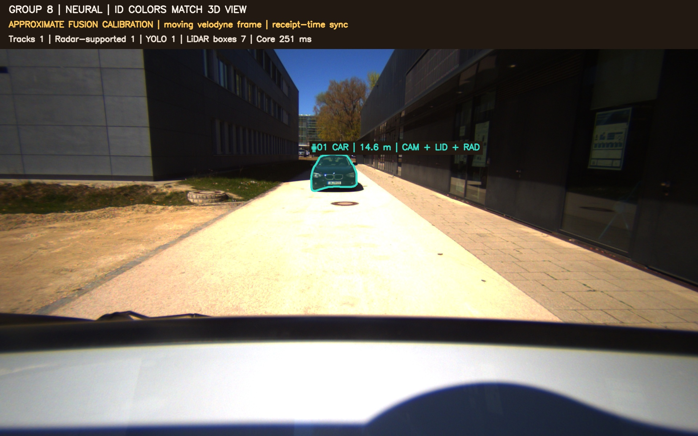

# A cleaner demo and safer outputs

The default display now focuses on camera masks and colored LiDAR object points.
Boxes, detector proposals and relative-motion vectors are separate optional
layers. The underlying LiDAR detector still predicts 3D boxes and exports them
through ROS; changing the display does not replace that detector.

## Run it

On the project laptop, from a graphical Ubuntu terminal:

```bash
cd /home/kshitij0/sensor_fusion
./scripts/run.sh ai-demo
```

For a top-down view, stop the demo with Ctrl+C and run:

```bash
./scripts/run.sh ai-birdseye
```

Both commands use the current neural v2 head and slow recorded playback. If
Docker reports permission denied, run
`sudo setfacl -m u:kshitij0:rw /var/run/docker.sock` on the host and try again.

The bird's-eye view uses RViz's built-in
[orthographic controller](https://github.com/ros2/rviz/blob/humble/rviz_default_plugins/src/rviz_default_plugins/view_controllers/ortho/fixed_orientation_ortho_view_controller.cpp),
with the rig's forward X direction shown upwards. It is a sensor-frame view,
not a globally localized map.

## What you see

| Display | Meaning |
| --- | --- |
| Camera masks | SAM instances drawn directly in image coordinates |
| Matching colors | The same track ID has the same color in the image and 3D view |
| Colored object points | Actual LiDAR returns inside an accepted, oriented detection box |
| Dim blue points | The surrounding raw LiDAR scene |
| Orange points | Raw radar returns, not individually detected vehicles |
| 3D track labels | Compact ID, class and planar distance from the rig |
| Distance rings | XY distances of 10, 20, 40 and 60 metres from the sensor origin |

Colored object points are **not learned 3D instance segmentation**. The neural
detector supplies the box; a geometric containment test selects existing points
for display. Overlapping boxes do not duplicate the same point. We do not
generate a solid surface or accumulate old points into a world map.



`CAM+LID+RAD` in the camera view means the accepted observation has camera, LiDAR and radar
support. A camera mask can remain visible with the label `visual only` when no
3D association passes the checks. Camera identities alone do not establish
correct 3D identity tracking.

Near-object 3D labels use smaller text and move towards the scene centerline to
reduce overlap. Set `visualization.detailed_labels: true` in a separate config
to add sensor provenance to 3D labels; the camera and track export always retain it.

## Why the camera cuboids were misleading

The old display projected a LiDAR box into the image using an assumed focal
length. That can put a cuboid beside or across the mask even when both are drawn
on the same camera frame. The bags also use receipt-time matching, which is a
separate timing approximation. Neither problem can be solved by making the box
look smoother or manually adjusting it until one frame looks aligned.

**Image-space cuboids are off by default.** The camera view uses masks from the
image itself. The banner still discloses approximate fusion calibration because
the learned association head continues to use that geometry. Removing a visual
projection does not fix the missing calibration inside fusion.

`visualization.projected_boxes: true` can explicitly enable the projection for
diagnosis in a separate configuration. It should not be presented as verified
alignment until real intrinsics and independent reprojection checks are available.

## Optional boxes and motion

In RViz's Displays panel, enable these only when you want to inspect them:

- **3D boxes (optional):** oriented outlines, subtle fill, a bottom footprint
  and a small chevron indicating detector yaw. Yaw is not direction of motion.
- **Relative motion estimates (optional):** ID-colored vectors close to the
  reference plane, with a small `v_rel estimate` label.
- **Unfused LiDAR proposals (optional):** grey detector proposals, explicitly
  labelled `LiDAR only`. These are not accepted fused tracks.

The motion display suppresses speeds below 1 m/s to avoid displaying small
direction changes as large visual cues. A vector represents a nominal
0.75-second displacement and is capped at 4 m for readability. The numeric
label is the uncapped relative-speed estimate. These are display settings, not
changes to the GRU's numeric output. Relative velocity is not absolute road
speed; ego-motion compensation and independent velocity labels remain missing.

## A concrete runtime defect we found

In the earlier v2 run, bag 1 track 4 moved from approximately `(6.82, 0.51)` to
`(6.67, -8.64)` metres between frames 191 and 192, then returned near its old
position at frame 193. The first transition implied about 92 m/s of relative
motion. That abrupt association change was a real output artifact.

The current runtime checks every selected 3D observation before exporting it:

- Box coordinates and yaw must be finite, and dimensions must be positive.
- With a recent observation for the same ID, position change must fit the
  configured motion envelope.
- A rejected observation is withheld. Its coordinates are not clipped,
  interpolated or replaced by an invented smooth trajectory.

The default short-gap envelope is `1 m + 30 m/s * elapsed time`, applied for gaps
of at most 0.5 seconds. This is an explicit assumption for this short-range demo,
not a universal road-speed limit. It is configurable under `neural.quality` in
`fusion_ai.yaml`. It can reject a valid fast relative motion and cannot detect
every wrong association or ID switch. The preserved v1 configuration disables
this new continuity check for historical comparison.

Metrics expose `rejected_3d_observations` for the current frame and
`quality_rejections_total` for the current replay sequence. The image reports
`3D withheld` when applicable. SAM's capacity-rejection counter now also resets
with its memory on a replay rewind.

## Marker and data handling

Each marker layer explicitly clears its previous contents before adding the
current frame. Track disappearance and replay rewinds therefore do not depend
only on marker expiry. Marker lifetimes use simulated time. Point clouds retain
the `velodyne` frame and the camera observation timestamp used by fusion.

No unverified uncertainty ellipses are shown. The exported covariance remains
a disclosed reporting heuristic. Numeric velocities and source provenance remain
available in `/fusion/tracks`, including when their optional display is hidden.

| ROS topic | Contents |
| --- | --- |
| `/fusion/image` | Masks, IDs and accepted association labels |
| `/fusion/instance_points` | XYZ and packed RGB for real matched object points |
| `/fusion/markers` | Labels, leaders, origin and distance guides |
| `/fusion/boxes` | Optional accepted-track cuboids |
| `/fusion/motion` | Optional relative-motion vectors |
| `/fusion/proposals` | Optional unfused neural LiDAR proposals |

## Layouts and customization

The launcher passes `ROS_DOMAIN_ID=8` by default. This keeps this project's ROS
traffic separate from the common default domain 0. Container shells inherit
that setting. Run one demo at a time. If you deliberately run independent
playbacks in parallel, assign different `ROS_DOMAIN_ID` values as well as
different container names. Two bag players in the same domain publish competing
clocks and sensor topics, causing resets and invalid synchronization. This was
observed during a preview test and corrected before publication.

The helper uses `results/fusion_ai_masks.rviz` for the road view and
`results/fusion_ai_masks_birdseye.rviz` for the top-down view. Older saved layouts
remain available. Resize the Camera fusion panel by dragging its dock divider,
and save the RViz configuration to retain your preferred panel sizes.

The source presets live under `src/group8_fusion/config`. To restore a preset,
stop RViz, move its saved file to a backup name, then launch again. The helper
creates a new copy. Model/data files are unaffected.

## What this release establishes

All **43 tests** passed in the container, and full GPU replay processed 235 and
162 camera frames with zero missing-LiDAR skips. The same trained v2 checkpoint
was used before and after the safeguard. An audit of exported tracks found:

| Existing recording | Before: abrupt transitions outside the demo envelope | After | Withheld observations |
| --- | ---: | ---: | ---: |
| studentProject | 2 transitions around the same bad observation | 0 | 1 |
| studentProject1 | 0 | 0 | 0 |

Bag 1's maximum short-gap position-difference speed fell from 92.3 to 3.68 m/s.
This is a consistency result, not measured vehicle speed or proof that every
remaining identity is correct. Bag 2's accepted observations were unchanged.

Reproduce the audit on the local saved runs with:

```bash
python3 scripts/audit_runtime.py
```

Published [before/after audit](validation/robustness/audit.json),
[full replay 1](validation/robustness/studentProject.json),
[full replay 2](validation/robustness/studentProject1.json) and
[runtime guard](validation/robustness/runtime_guard.json) preserve the evidence.
Live [road-view](validation/robustness/road_ros.json),
[bird's-eye launch](validation/robustness/birdseye_ros.json) and
[isolated preview](validation/robustness/isolated_preview_ros.json) observers
received the camera, object, colored-point, marker and optional diagnostic topics.
The isolated preview used domain 9 and produced no clock-reset warnings.

Tests cover oriented geometry, clipped camera rendering, consistent ID colors,
real-point ownership, RGB serialization, separate marker layers, stale-marker
clearing, reset behavior and the continuity check. Full replay and live RViz
checks are recorded with the release evidence.

This improves display quality and rejects a specific failure pattern. It does
not establish production perception accuracy or guarantee a grade. The honest
remaining limits are approximate calibration and timing, short related bags,
weak training labels, finite SAM slots, possible identity drift and throughput
below the camera's original 10 Hz. See [project explanation](START_HERE.md),
[v2 experiments](FUSION_V2.md) and [run commands](RUN_GUIDE.md).
