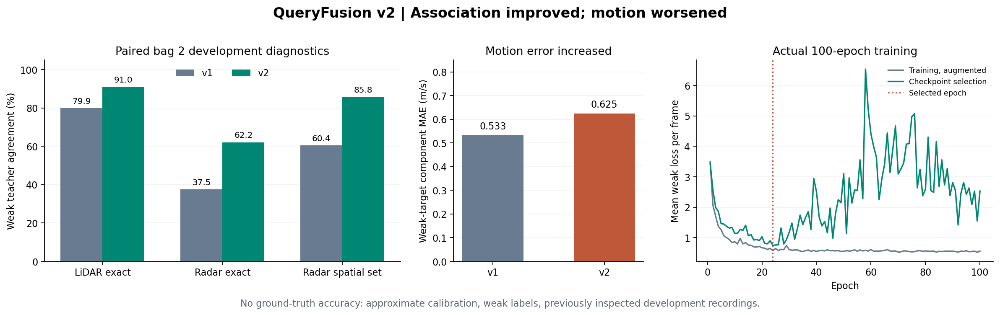
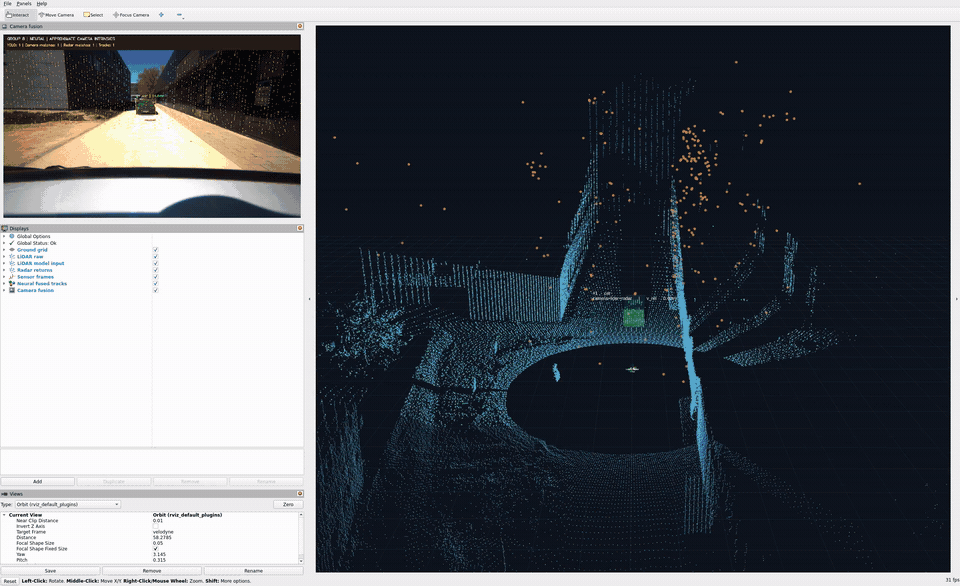

# QueryFusion v2: what improved and what did not

Measured on 22 October 2026. Read the [plain-language project guide](START_HERE.md)
first if the terminology is unfamiliar. The original results in
[AI_RESULTS.md](AI_RESULTS.md) describe v1 and remain available for comparison.

## Why make another version?

The v1 head had two visible weaknesses. Zeroing camera descriptors improved its
LiDAR teacher agreement, suggesting that the descriptor branch could hurt
association. Radar supervision selected a single nearest point even when several
nearby returns were plausible. Exact radar teacher agreement was only 37.5% on
bag 2. More architecture names would not address those measured problems.

## What changed in the code?

| Change | Purpose | Actual scope |
| --- | --- | --- |
| Separate descriptor and geometry encoders | Prevent descriptor statistics from rescaling coordinates/classes | Camera and LiDAR branches |
| Learned camera descriptor gate | Let the head reduce a descriptor's contribution | A sigmoid gate, not verified sensor reliability |
| Contextual radar transformer | Let each radar token use surrounding return evidence | One self-attention encoder before cross-attention |
| Descriptor dropout | Reduce dependence on one learned feature source | Camera 35%, LiDAR 15% during training |
| Radar augmentation | Train with missing radar and missing velocity/RCS attributes | 15% probability each during training |
| Spatial radar target distribution | Allow several plausible returns to share supervision | Gaussian weights within 3 m of a weak LiDAR teacher, sigma 1.5 m |
| LiDAR label smoothing | Avoid an infinitely confident fit to noisy labels | Smoothing factor 0.02 |
| Separate temperature fitting segment | Adjust probability concentration after checkpoint selection | Weak-label calibration only |
| Versioned loader and checkpoints | Keep v1 reproducible and prevent incompatible loads | Strict schema and state-dict validation |

The GRU still estimates motion. The 3D center and box dimensions still come
from VoxelNeXt. V2 does not learn a new 3D box refinement or world-frame tracker.
It is a project-specific head, not a reproduction of MoME, RAF or RaCFormer.

## Training and split rules

The perception backbones and cached features are identical to v1. Only the
130,629-parameter fusion/motion head is optimized. We used 100 epochs, seed 8,
AdamW at learning rate 0.001 and weight decay 0.01, gradient clipping at 1 and
eight-frame truncated backpropagation. The selected checkpoint is epoch 24.

| Bag 1 frames | Use |
| --- | --- |
| 0 to 163 | Gradient updates |
| 164 to 187 | Purge gap |
| 188 to 210 | Checkpoint selection |
| 211 to 234 | Temperature fitting after selection |

The fixed temperature grid is 0.5, 0.75, 1, 1.5, 2, 3, 5 and 8. The fitted
values were 0.5 for LiDAR and 1 for radar. LiDAR probabilities become sharper,
not automatically more trustworthy. Tiny, related weak-label segments cannot
establish calibration against physical truth.

**Bag 2 is development data.** It was inspected in v1 and helped motivate the
new design. It was excluded from gradient updates and checkpoint selection,
but is no longer an untouched test. We did not tune another model after seeing
these v2 comparisons. A new recording is needed for a fresh test.

## Paired development comparison

Both heads were reloaded and evaluated against the same cached bag 2 features
and the same diagnostics: 162 frames and 288 visual queries, including null
teacher cases. These are weak-label diagnostics, not real-world accuracy.

| Measurement | v1 | v2 |
| --- | ---: | ---: |
| Exact LiDAR teacher agreement | 79.9% | 91.0% |
| Exact nearest-radar teacher agreement | 37.5% | 62.2% |
| Radar spatial-set teacher agreement | 60.4% | 85.8% |
| LiDAR selections above 0.65, out of 288 | 213 | 188 |
| Teacher agreement among those LiDAR selections | 77.0% | 87.2% |
| Radar selections above 0.35, out of 288 | 240 | 81 |
| Spatially plausible fraction among those radar selections | 60.4% | 79.0% |
| Relative XY velocity component weak-target MAE | 0.533 m/s | 0.625 m/s |

Spatial-set agreement accepts any return within the disclosed teacher radius,
or the null token when no teacher-supported return exists. It is easier than
exact point agreement and uses the same weak geometry. Both heads are scored
with this same new diagnostic. It does not verify which surface reflected a
real radar return.

V2 improves association diagnostics but exports fewer confident associations,
especially radar support, and its motion diagnostic worsens. The confidence
threshold comparison is made before the runtime's duplicate suppression and
5 m radar safety gate. These counts are not runtime track totals or distinct
objects. The combined bag 1 validation/calibration segment has 94 queries;
LiDAR agreement is 97.9% and exact radar agreement is 81.9%. That segment was
used in development and does not establish generalization.



## Missing inputs and feature sensitivity

| V2 diagnostic on bag 2 | LiDAR teacher agreement | Exact radar teacher agreement |
| --- | ---: | ---: |
| Unmodified | 91.0% | 62.2% |
| Camera descriptor zeroed | 91.7% | 66.3% |
| LiDAR descriptor zeroed | 80.6% | 49.0% |
| Radar velocity/RCS attributes zeroed | 91.0% | 63.9% |

Camera descriptor removal still gives a small improvement. That branch has not
demonstrated a net benefit on these recordings. Removing LiDAR descriptors
hurts agreement. Radar attribute removal changes the result but does not
establish that recorded velocity/RCS improve accuracy. Retained proposals and
geometry mean these feature perturbations are not full sensor-removal tests.

With all radar tokens removed, outputs remain finite and every radar selection
is null. With all LiDAR candidates removed, every LiDAR selection is null, so
the runtime cannot export a fused 3D track. Internal radar attention may still
select a return in that test; we do not call it independent radar perception.
These are cached-head failure checks, not new adverse-weather sensor recordings.

## Full GPU inference and ROS/RViz

The delivered checkpoint was reloaded for full inference on both raw bags. This
executes YOLO, SAM, VoxelNeXt and v2 rather than only replaying cached features.

| Recording | Processed frames | Median core latency | p95 core latency | Accepted camera/LiDAR observations | Radar-supported observations |
| --- | ---: | ---: | ---: | ---: | ---: |
| studentProject | 235 | 258.3 ms | 262.6 ms | 359 | 313 |
| studentProject1 | 162 | 262.1 ms | 275.0 ms | 186 | 66 |

Neither run skipped a frame for missing LiDAR. Counts sum observations across
frames, not distinct real objects. Core latency excludes decoding, annotation,
video encoding and ROS transport. Cold-start maxima exceeded one second. These
runs were not a controlled paired speed benchmark against v1; hardware state
and scheduling can vary. The system still cannot process a 10 Hz camera at full
rate, so demo playback remains at 0.1 speed.

All **31 tests** passed in the AI container, and the dependency check found no
broken requirements. The five-frame GPU guard passed with zero calls to the
disabled classical clustering/association/tracking routines. A 25-second live
observer received 25 each of image, cloud, object, marker, track and metric
messages, plus static TF. All five required RViz subscriptions were present.
Its last sample identified `group8-query-fusion-v2` and zero internal image drops.
Those checks establish execution and delivery, not perception accuracy.



## Reproduce and inspect

```bash
cd /home/kshitij0/sensor_fusion
./scripts/run.sh ai-build
./scripts/run.sh ai-test
./scripts/run.sh ai-train \
  --output /models/query_fusion_v2_reproduced.pt \
  --report /results/ai_training_v2_reproduced.json
./scripts/run.sh ai-demo
```

Training needs `results/ai_features` from `ai-extract`. The demo uses the
delivered v2 checkpoint unless you explicitly change its configuration.

Published evidence: [training, paired comparison and stress report](validation/neural_v2/training.json),
[full bag 1](validation/neural_v2/studentProject.json),
[full bag 2](validation/neural_v2/studentProject1.json),
[runtime guard](validation/neural_v2/runtime_guard.json),
[live ROS/RViz observer](validation/neural_v2/ros_live.json),
[environment](validation/neural_v2/environment.json) and
[check summary](validation/neural_v2/checks.txt).
The original `models/query_fusion.pt` and `fusion_ai_v1.yaml` remain available.
Current configuration uses `models/query_fusion_v2.pt` with schema
`group8-query-fusion-v2`; its SHA256 is
`45af5f681d1259ba12909ea2e6fe5c35713833b7dfcaa7d165c51c6dd8ffb687`.

See [run guide](RUN_GUIDE.md) for Docker, ROS, RViz and comparison commands.
