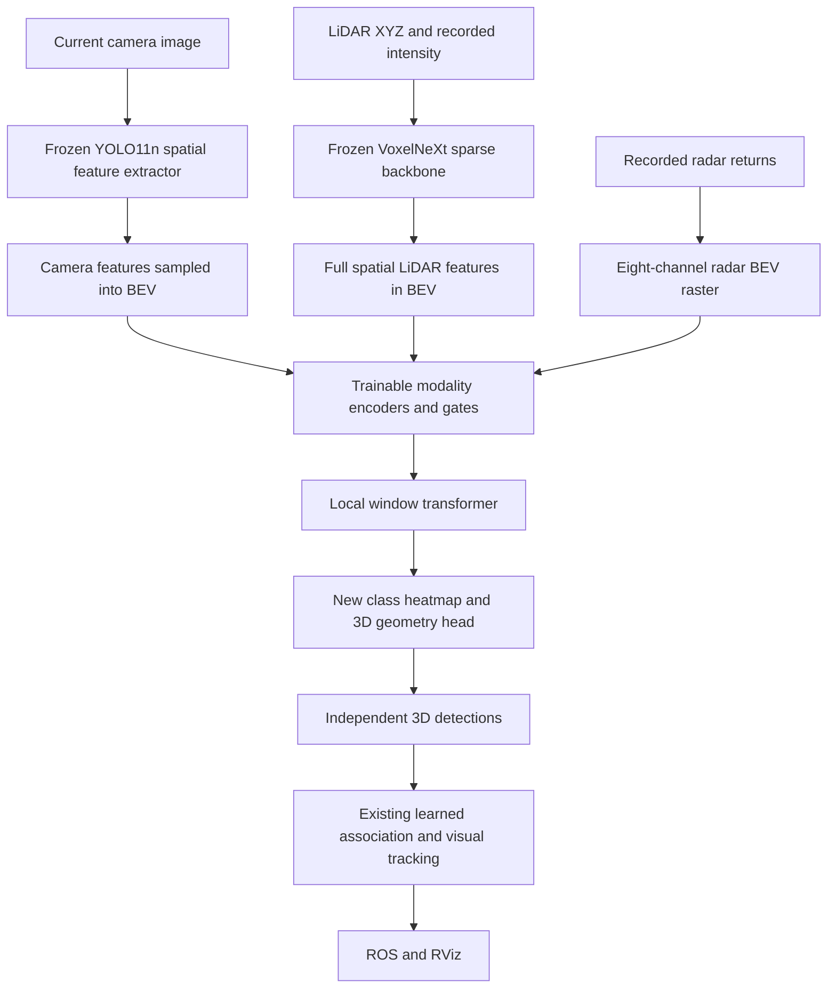
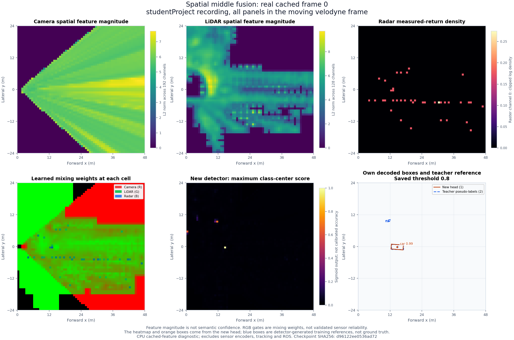
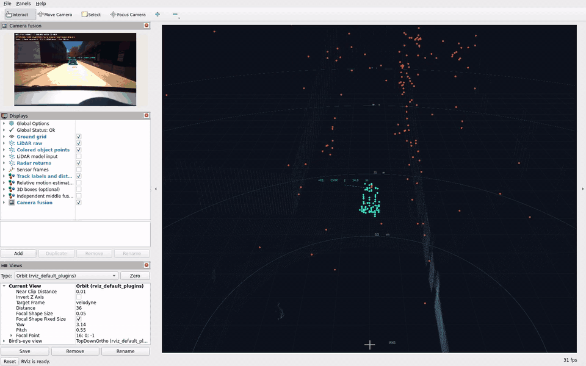

# Middle fusion: let the sensors contribute before detection

The new experimental profile combines spatial camera, LiDAR and radar features
before predicting its own 3D objects. It sits alongside the stable QueryFusion
v2 profile so that we can compare two different ways of using the same sensors.

This is a project-specific model, not a reproduction of BEVFusion, RaCFormer or
RAF. Its large feature extractors stay frozen. The new fusion and detection
head is trained locally using detector-generated labels. Real camera calibration
and independent accuracy labels are still missing.

For the existing profile and terminal instructions, see [Start here](START_HERE.md)
and the [run guide](RUN_GUIDE.md). The [literature review](LITERATURE_REVIEW.md)
explains the research behind these choices.

## What changes for one car?

QueryFusion v2 first gets complete 3D proposals from VoxelNeXt. It then learns
which proposal belongs to each camera mask and which radar returns support it.
The final 3D center and dimensions come from the selected LiDAR proposal.

The middle profile gives the new detector a map of learned sensor features
instead. A cell in front of the vehicle can contain visual appearance, LiDAR
shape features and radar evidence. The model combines that information and
predicts an object center, class, dimensions and orientation. It does not select
a completed VoxelNeXt box as its final detection.

| Question | QueryFusion v2 | Experimental middle profile |
| --- | --- | --- |
| What enters the fusion model? | Visual object queries, LiDAR proposals and radar tokens | Spatial feature maps from the three sensors |
| When are the sensors combined? | After initial object proposals | Before the new detector's predictions |
| Where does the final 3D geometry come from? | A selected VoxelNeXt proposal | The new fused detection head |
| Does it need camera proposals to generate 3D detections? | Yes, for exported visual 3D tracks | No, for the independent 3D detector |
| How are displayed visual identities maintained? | SAM memory and learned association | The existing association, SAM memory and motion stages after detection |

Detection and tracking remain separate. Producing a 3D detection without a
camera mask does not automatically give it a persistent visual ID. The existing
tracking stage retains its camera visibility and capacity limitations.

## A small shared map, measured in meters

Bird's-eye view, or BEV, means looking down at the scene. Our map covers
0 to 48 m forward and 24 m to either side in the moving `velodyne` frame.
Each cell spans 0.75 m, giving a 64 by 64 grid. This front-facing region matches
the scope of the single-camera experiment and keeps memory use manageable on
the 8 GB laptop GPU. It is not a global map or a full surround-view system.





This diagnostic uses cached frame 0 from `studentProject`, with axes in the
moving `velodyne` frame. The first three panels show actual sensor feature maps;
the next two show learned mixing weights and the new head's class-center
scores. Orange footprints come from the new detector. Blue dashed footprints
are recorded teacher pseudo-labels, including a teacher observation that the
new head misses. Feature magnitudes and mixing weights are not accuracy or
validated sensor reliability.

Reproduce this CPU-only figure without running the sensor encoders:

```bash
python3 scripts/plot_middle.py
```

It reads `results/middle_features/studentProject/00000.npz` and
`models/middle_fusion.pt`. The script accepts `--frame`, `--weights` and
`--output`, and records the actual file hashes in its output. It must be rerun
after replacing the checkpoint to keep the image current.

### Camera: appearance from every current image

The camera branch uses the published YOLO11n PyTorch weights and its P3 and P4
feature maps. These are internal spatial representations, before finished box
predictions. The input is center-letterboxed to 640 by 640 pixels. P3 has
64 channels and P4 has 128; P4 is resized to the P3 resolution, producing a
192-channel map at 80 by 80 locations. This branch processes each current image
even when there are no camera detections or SAM masks.
The TensorRT proposal engine remains useful for the separate visual tracker;
it is not the source of these dense camera features.

To place image features on the metric grid, the implementation projects BEV
locations into the image using the recorded sensor transform and the configured
camera matrix. For each cell it samples three fixed heights in the LiDAR frame:
-1, 0 and 1 m. Valid samples are averaged. A visibility mask marks samples that
fall in front of the camera and inside the image. Out-of-view cells do not
receive invented image features.

This is a deliberately disclosed approximation. Those heights are a heuristic,
not measured surfaces or learned depth. They cannot describe every object, and
assumed intrinsics can select the wrong image region. The learned gate does not
recover missing calibration. Real intrinsics and a validated lifting method
remain necessary for accurate spatial camera fusion. Projected camera cuboids
stay optional in the viewer.

### LiDAR: internal shape features, without the old detector head

The LiDAR branch retains VoxelNeXt's published nuScenes backbone. It consumes
XYZ and recorded intensity, plus a zero time-lag channel for the current sweep.
The full 128-channel sparse spatial representation is mapped onto the shared
grid. It is not reduced to one descriptor per predicted object.

Detection support can include a 5 by 5 neighborhood around supported LiDAR
cells, reaching 1.5 m along each grid axis. This lets local context predict a
box center between measured surfaces. It expands the eligibility mask, not the
measured returns or feature values. It must not be displayed as newly observed
occupancy or used to claim that empty space has been measured.

In middle-profile inference, VoxelNeXt's original detection head is not executed.
The new fused head makes the predictions. During feature extraction for
training, the original detector is used separately to generate teacher boxes.
Those teacher boxes are targets, not inputs to the new runtime detector.

### Radar: measured returns, not imagined objects

Radar points are transformed into the same frame and rasterized into an
eight-channel BEV representation. The representation draws on recorded point
geometry, velocity, reflection strength and support information. Rasterization
and normalization organize measurements; they are not learned radar detection.
The radar encoder inside the new model is trained with the fusion head.

The recorded velocity convention has not been independently verified. It is
therefore an input attribute, not a guarantee of absolute road speed or a basis
for claiming validated ego-motion compensation.

### Fusion: learn where each sensor helps

Trainable modality encoders turn the three inputs into compatible features.
Availability masks distinguish absent or unsupported evidence from a numerical
zero. Learned gates weight the branches, and a local window transformer lets
neighboring cells exchange context. Attention stays local to keep computation
bounded on the project hardware.

The final head predicts a class center heatmap and geometry: offsets within a
cell, height, dimensions and yaw. Decoding, coordinate transforms, range checks
and duplicate suppression remain explicit non-learned operations. This is
normal engineering around a neural model and is documented as such.

## What does "end to end" mean here?

For this release, one training loss updates the new modality encoders, gates,
local transformer and detection head together. Gradients stop at the cached
camera and LiDAR features. The published YOLO and VoxelNeXt backbones are not
fine-tuned. SAM memory and the existing association/GRU stage are not jointly
trained by this detection loss.

We can therefore say **the new fusion and detection head is trained together**.
We cannot say the whole system was jointly trained from raw pixels and point
clouds to persistent tracks.

A future raw-input training mode would need to run the encoders inside the
training graph, unfreeze selected layers, preserve differentiable feature
sampling and optimize them with the detector. Joint temporal tracking would
add another training boundary. Independent labels, more varied scenes and
careful memory management would be needed before claiming that experiment had
been completed. A diagram or configuration switch alone does not establish it.

A one-frame backward guard can check that gradients reach selected camera and
LiDAR encoder parameters through the fusion head. That would establish a
possible optimization path. It would not mean those encoders were fine-tuned
over the multi-epoch training run, or that the path improves accuracy. The
training report and any backward-guard evidence must be read separately.

## How can we train without manual 3D labels?

We use confidence-filtered predictions from the published VoxelNeXt detector as
pseudo-labels. The new model learns to approximate those targets while combining
the sensor features. Freezing the large backbones limits the amount of training
needed on the 397 supplied images.

This gives us an executable training experiment, not independent truth. The
teacher can miss objects, predict wrong dimensions or have domain errors. A
cell without a teacher box is not proven free space. Agreement with the teacher
does not show that camera or radar improved real-world detection accuracy.
The teacher and student also share LiDAR features, which makes their agreement
less independent.

The split keeps model fitting, checkpoint selection and threshold fitting in
separate chronological segments of bag 1:

| Bag 1 frames | Use |
| --- | --- |
| 0 to 163 | Gradient updates |
| 164 to 187 | Purge gap |
| 188 to 210 | Checkpoint selection by loss |
| 211 to 234 | Score-threshold fitting after checkpoint selection |

Bag 2 is **development data**: we have already inspected it while improving
earlier versions. It must not be described as a fresh untouched test. All
related frames from the same short scene remain a limited generalization test.

## What the training experiment actually showed

The [saved training report](validation/middle/training.json) records two
90-epoch runs with seed 8: the full fusion head and an identically sized
LiDAR-only control. Each has 58,334 parameters. Published camera and LiDAR
encoders stayed frozen. AdamW used an initial learning rate of 0.001, weight
decay 0.01 and batch size 8. Training included modality dropout and small
camera feature-map shifts. Teacher boxes needed a score of at least 0.35.

The fusion checkpoint was selected at epoch 25 and the control at epoch 32.
Their score thresholds were fitted independently on the same calibration
segment: 0.8 for fusion and 0.9 for the LiDAR-only control. The comparison
therefore uses each model's selected threshold, not one common operating point.

We match each prediction to at most one same-class teacher center within 2 m.
Precision and recall in the report describe agreement with that teacher; their
F1 score summarizes the two. This is a center-based diagnostic, not 3D box IoU
accuracy, mAP or an independent measure of real objects.

| Diagnostic | Full fusion | Trained LiDAR-only control |
| --- | ---: | ---: |
| Bag 1 checkpoint-selection teacher-center F1 | 0.644 | 0.644 |
| Bag 1 threshold-fitting teacher-center F1 | 0.929 | 0.894 |
| Bag 2 development teacher-center F1 | 0.889 | 0.847 |
| Bag 2 predictions / matched teacher observations | 161 / 160 | 148 / 147 |
| Bag 2 teacher observations recovered, out of 199 | 160 | 147 |
| Mean XY center difference from matched teachers | 0.073 m | 0.065 m |
| Mean box-size component difference from matched teachers | 0.100 m | 0.201 m |
| Mean yaw difference from matched teachers | 0.222 rad | 0.100 rad |

The fused head recovers more teacher observations in this development run, but
its matched center and yaw differences are worse than the control's. The
threshold-fitting segment helped choose the threshold, so its score is not an
independent validation result. These observations support a limited engineering
comparison, not a claim of sensor superiority or state-of-the-art accuracy.
Counts sum observations across frames, not distinct vehicles.

### The camera branch has not demonstrated a benefit

The following checks remove a complete cached feature branch and its
availability mask while leaving the trained fusion checkpoint and score
threshold unchanged. They do not reproduce a real sensor outage, missing ROS
messages or adverse weather, and they do not evaluate the downstream tracker.

| Bag 2 cached-head diagnostic | Teacher-center F1 |
| --- | ---: |
| All three feature branches | 0.8889 |
| Camera branch removed | 0.8895 |
| Radar branch removed | 0.8693 |
| LiDAR branch removed | 0.8464 |
| All feature branches removed | 0.0000, with zero predictions |

Removing the camera branch gives a slightly better score. We therefore cannot
claim that visual features improve detection on these recordings. The radar
removal reduces teacher agreement, but this still does not establish better
physical accuracy. All-missing input produces no detections, as intended; its
zero F1 is not a useful accuracy comparison against nonempty teacher targets.
Outputs remained finite in these cached-head checks.

The model also retained F1 0.8889 after a one-cell camera feature-map shift and
0.8827 after a two-cell shift. Those are artificial shifts of cached features,
not verified camera-calibration error or weather tests.

### It mainly learned the dominant car

On bag 2, all 160 matched teacher observations were cars. It recovered 160 of
162 car teacher observations. It did not recover the teacher's 2 bus, 10 trailer,
1 motorcycle, 21 bicycle or 3 pedestrian observations. Some teacher labels may
themselves be wrong, but their absence from the student's output must not be
hidden behind the aggregate score. This is not a demonstrated general-purpose
ten-class detector, even though its output head has ten class channels.

The strong car result after removing LiDAR is also not evidence of reliable
camera/radar depth recovery. These recordings contain a repeated dominant car
in a related scene, so scene memorization is a plausible explanation. An unseen
scene with independent labels is needed to separate that from generalization.

### Timing has a narrow boundary

The two cached-feature training runs and their diagnostics took 83.7 seconds;
peak PyTorch allocated GPU memory was about 280 MiB. On bag 2 the fusion head's
median inference time was 1.10 ms, with p95 1.51 ms. These figures exclude the
frozen image and LiDAR encoders, feature extraction, image decoding, SAM,
association, ROS transport and rendering. They are not full-system frame rate
or total GPU-memory measurements.

### Full raw-bag and live-view checks

The ROS Humble GPU container passed **112 tests** and its Python dependency
check. The independent-head guard runs with the original VoxelNeXt detection
head, its detector entry point, classical clustering/assignment/tracking, and
the spatial camera branch's YOLO detection head replaced by failing stubs.
It still produces independent detections. The separate YOLO proposal engine is
allowed to prompt visual identities. Cached and raw-runtime feature maps agree
within float16 cache rounding on frame 0. Missing radar and an empty LiDAR
cloud also pass the raw runtime checks.

| Complete recording | Processed frames | Independent detection observations | Median / p95 core latency | PyTorch peak allocation |
| --- | ---: | ---: | ---: | ---: |
| studentProject | 235 | 309 | 256 / 262 ms | 1084 MiB |
| studentProject1 | 162 | 161 | 259 / 270 ms | 1084 MiB |

All 397 camera frames were processed, with no missing-LiDAR skips. The 470
independent detections count per-frame observations, not distinct objects.
The association adapter produced 292 and 160 accepted visual 3D observations,
respectively. Its camera visibility and identity-capacity limits still apply.
Core latency includes sensor encoders, feature alignment, middle detection,
SAM and association; it excludes ROS transport, image annotation and rendering.
The first frame took about 1.2 seconds. PyTorch allocation excludes TensorRT
and driver allocations. This pipeline has not achieved 10 Hz processing.

A live observer received 62 synchronized output frames and 70 independent
detections over 30 seconds at `rate:=0.2`, checked sensor TF and all required
RViz subscriptions, and reported no errors. This preview used a private ROS
domain so its clock could not interfere with another demo. Masks and colored
measured points remain the default display; detector boxes are optional.



The preview is an actual RViz window recording. The full MP4 stays under local
`results/middle-rviz.mp4`. The [static image](assets/middle-rviz.png) and the
[ROS observer report](validation/middle/ros_live.json) accompany it.

The separate one-frame backward integration check reaches 159 camera parameter
tensors, 121 LiDAR parameter tensors including the first sparse convolution,
all 46 fusion-head parameter tensors, image pixels and radar attributes. All
observed gradients are finite. It performs **zero optimizer steps**. This proves
the wiring needed for future fine-tuning; it does not mean the published
backbones were jointly trained in the delivered experiment. Discrete LiDAR
voxelization is not a differentiable raw-point-coordinate model.

The [training report](validation/middle/training.json),
[GPU guard](validation/middle/runtime_guard.json),
[bag 1 run](validation/middle/studentProject.json) and
[bag 2 run](validation/middle/studentProject1.json) contain the measured evidence.
The profile remains experimental alongside the stable v2 demo.

## Read the outputs correctly

| Output | Meaning |
| --- | --- |
| `/fusion/detector_objects` | All independent fused 3D detections for this frame, without persistent IDs |
| `/fusion/objects` and `/fusion/tracks` | The subset accepted by the transferred visual identity and motion adapter |
| `/fusion/proposals` | Optional geometry of all new detections, labelled `BEV fusion` |
| `/fusion/instance_points` | Measured LiDAR points inside accepted tracked boxes, colored by visual ID |
| `detector_objects.json` in an offline run | Per-frame independent box, label and score exports |

In middle-profile metrics, `detector_objects` is the independent detector count.
The older `lidar_objects` key carries that same count for compatibility; it no
longer means that a LiDAR-only detection head ran. `radar_objects` counts filtered
radar returns, not learned radar objects. Track `sources` describe the downstream
association evidence; they are not measurements of each feature branch's causal
contribution. Gate averages are routing weights, not calibrated reliability.

The independent detector predicts box geometry and class. Its nine-column array
retains two zero velocity slots for the existing adapter format. Those zeros are
not speed measurements. Only accepted visual tracks receive the existing GRU's
experimental relative motion estimate. That adapter has not been retrained on
the new detector's candidates, and no global ego-motion compensation is claimed.

## Run it and reproduce the training

Use a host terminal. The middle profile shares the AI Docker image and published
models with the existing neural profile, but has its own configuration, trained
head and saved RViz preferences. `mid-build` builds `Dockerfile.ai`; it does not
create a second CUDA/ROS dependency stack. Rebuild after pulling new source.

```bash
cd /home/kshitij0/sensor_fusion
./scripts/run.sh mid-build
./scripts/run.sh mid-test
./scripts/run.sh mid-demo
```

Stop any earlier demo before launching this one. Both use the container name
`group8-rviz` and ROS domain 8 by default. The middle view saves preferences to
`results/fusion_middle_masks.rviz`; it does not overwrite v2's view. The middle
demo selects `fusion_middle.yaml`, the camera proposal TensorRT engine and
`rate:=0.1`. Slow playback is a processing setting, not a real-time claim.

For headless evaluation and runtime checks:

```bash
./scripts/run.sh mid-evaluate /data/studentProject1 \
  --weights /models/yolo11n.engine \
  --output /results/my_middle_evaluation --video
./scripts/run.sh mid-check
# Optional, after extracting the default local feature cache:
./scripts/run.sh mid-check --backward
./scripts/run.sh mid-validate /results/my_middle_validation
```

These commands run checks; they do not establish that a check has passed until
its report confirms it. Preserve existing evidence by choosing fresh output
paths. To inspect the environment interactively, use `./scripts/run.sh mid-shell`.

Training is reproducible separately from the demo. Use new paths to keep the
delivered model and earlier feature caches intact:

```bash
./scripts/run.sh mid-extract --output /results/middle_features_reproduced
./scripts/run.sh mid-train \
  --features /results/middle_features_reproduced \
  --output /models/middle_fusion_reproduced.pt \
  --report /results/middle_training_reproduced.json \
  --lidar-baseline
```

The defaults are `/results/middle_features`, `/models/middle_fusion.pt` and
`/results/middle_training.json`. A reproduced checkpoint does not silently
replace the default. To deploy it, copy `fusion_middle.yaml`, change that copy's
checkpoint path and pass the configuration explicitly. See the
[run guide](RUN_GUIDE.md) for Docker access, model preparation and stopping RViz.

## What evidence would make this a useful improvement?

The new profile must demonstrate more than a different architecture name:

- It must run on both complete raw bags and deliver valid ROS/RViz outputs.
- Its predictions must come from the new head, without teacher boxes supplied
  at runtime or an invisible fallback to VoxelNeXt detections.
- Tests must cover absent sensors, non-finite inputs, bounds and the camera
  feature extraction path when no image proposal exists.
- Whole-branch removals and calibration perturbations must be reported, along
  with prediction coverage. Zeroing one descriptor is a narrower experiment.
- Latency and GPU memory must include the stated processing boundary.
- Teacher agreement must be labelled as such. Detection accuracy, identity
  accuracy and reliable uncertainty require independently annotated data.

Results are recorded after validation in the
[middle-profile evidence directory](validation/middle/), including the training
report, model provenance and runtime checks. Pending checks are not counted as
passed. Use those reports for measured values and the run guide for the final
commands; architecture alone does not establish performance.

The camera masks and colored LiDAR object points remain the main display.
Optional boxes help inspect the new detector's geometry without forcing an
uncalibrated cuboid onto the camera image.
