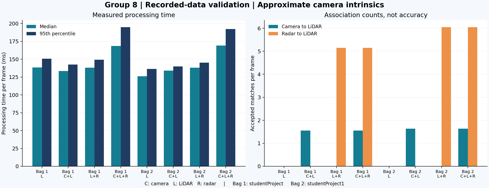
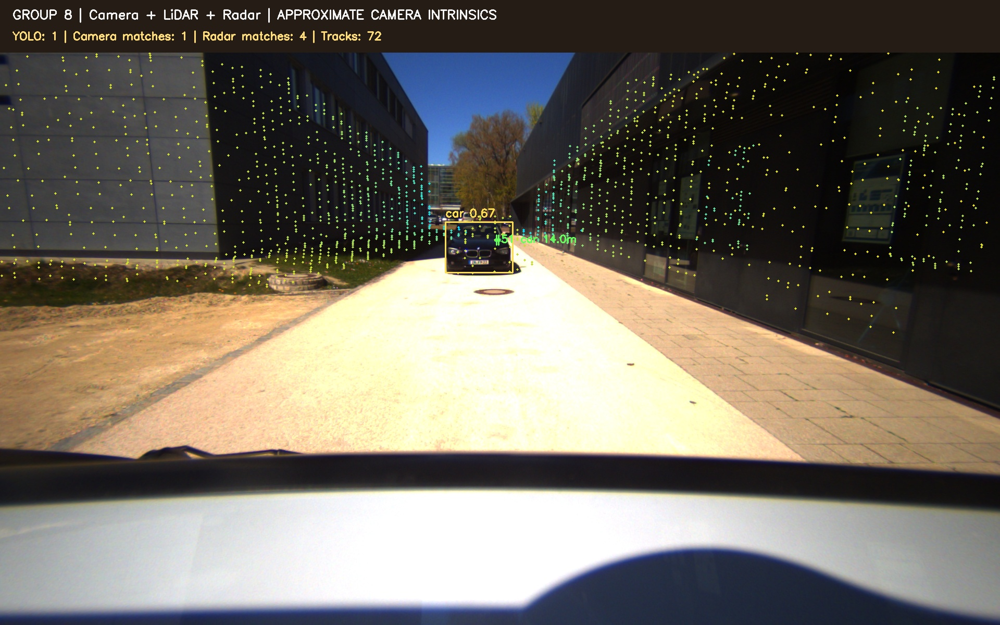
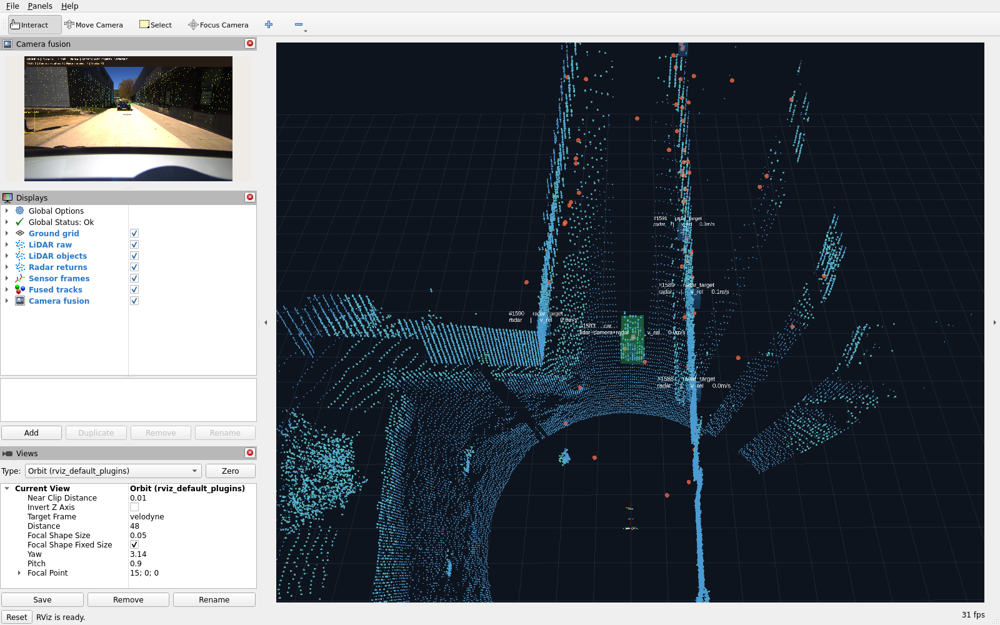

# AI-based multi-sensor fusion for automated vehicles

Team Project Group 8, THI. Implementation and local validation: 17 October 2026.

## Scope and outcome

This project implements a ROS 2 perception pipeline for the two supplied driving
recordings. Camera semantics are combined with LiDAR geometry and radar target
positions, followed by temporal tracking. The implementation runs inside
`nvcr.io/nvidia/tensorrt:23.08-py3`, extended with ROS 2 Humble Desktop. It includes
reproducible playback, offline exports, numerical tests and RViz visualization.

The course introduction asks for spatial alignment, multi-sensor detection
association, object tracking, a literature review and a ROS 2 implementation.
The chosen approach is object-level fusion with a pretrained camera neural
network and geometric range-sensor detectors. No task-specific training or
learned radar/LiDAR detector is represented as completed.

The supplied data lacks camera intrinsics, ground-truth labels and ego pose.
Consequently the delivered system is a functional recorded-data baseline with
an explicitly approximate camera projection. A real calibration can be imported
and the complete pipeline rerun. It is not an accuracy-validated driving system.

## Data audit

| Recording | Duration | Images | LiDAR clouds | Radar clouds | IMU messages | Static TF messages |
| --- | ---: | ---: | ---: | ---: | ---: | ---: |
| studentProject | 23.585 s | 235 | 236 | 471 | 2,359 | 3 |
| studentProject1 | 16.375 s | 162 | 164 | 327 | 1,638 | 3 |

Images are 1920 x 1200 BGR. The first LiDAR cloud is organized as 128 x 512
points with XYZ, intensity and ring fields. Radar messages include XYZ, `v`,
range, RCS, azimuth and elevation. Point-cloud decoding respects each field's
offset, datatype, endianness and row stride, including the radar's unaligned
29-byte point layout.

The recorded frame tree connects `velodyne` to `cam0`, `radar`, `os_lidar` and
`ouster/imu_link`. The full translations and quaternions are preserved in the
[machine-readable audit](dataset_audit.json). Source bags are opened read-only.

## Spatial and temporal alignment

The reference frame is the LiDAR frame `velodyne`. Camera projection uses the
inverse of the recorded camera-to-LiDAR transform and a pinhole intrinsic matrix.
Only points in front of the camera are projected. The radar transform is applied
before distance association, so measurements are compared in a common frame.

Default fx = fy = 1100 px, cx = 960 px and cy = 600 px are assumptions, not a
calibration result. The image overlay and logs clearly expose this status.
`scripts/import_calibration.py` reads a real ROS calibration's rectified
projection matrix into a fresh configuration and rejects invalid dimensions,
invalid focal lengths and unreviewed stereo projection translations.

LiDAR and IMU use device uptime in their headers; camera and radar use Unix-like
time. Direct header matching would fail. The replay node uses recorded receipt
timestamps for sensor headers and `/clock`. The offline runner uses the same
timeline. The maximum nearest receipt-time LiDAR delta is 50.46 ms for the first
bag and 36.33 ms for the second; radar maxima are 13.80 ms and 21.99 ms. All are
inside the configured 100 ms tolerance, but this does not establish acquisition
synchronization. See [calibration and time](CALIBRATION.md) for the limitations.

## Detection and fusion

The camera uses COCO-pretrained YOLO11n with 640-pixel input and confidence 0.30.
The local export uses ONNX opset 17 and TensorRT FP16. Its checkpoint, ONNX and
engine hashes are retained with the validation evidence. Engines are local to
the deployment hardware and TensorRT release.

LiDAR processing removes nonfinite points and the vehicle footprint, crops a
configured ROI, voxel-reduces at 0.25 m, removes an upward ground plane with
RANSAC, and clusters remaining points using KD-tree DBSCAN. Clusters produce
axis-aligned geometric boxes. Size filtering removes some ground remnants and
large structures, but unclassified clusters can still represent buildings.

Radar detections are transformed into the LiDAR frame, filtered by range and
height, and clustered in XY. The recorded radial velocity is preserved as a
sensor quantity. No undocumented upstream CFAR implementation is assumed.

Projected LiDAR boxes and camera boxes are assigned one-to-one using Hungarian
matching on IoU, with a minimum overlap of 0.05. Matched camera labels and
confidence attach to the 3D obstacle. Radar clusters and LiDAR objects are
matched one-to-one with a 2.5 m XY gate. Matched XY measurements are combined by
inverse-variance weighting. The variances are heuristic; the independence
assumption has not been validated on these recordings. Unmatched radar clusters
remain separate radar targets, and unmatched LiDAR objects remain obstacles.

## Tracking

Each track has state `[x, y, vx, vy]` in `velodyne`, a 4 x 4 covariance, an ID,
measurement provenance and a confirmation count. A constant-velocity Kalman
filter predicts between measurements. Hungarian assignment is gated by both a
3 m Euclidean distance and a 2D Mahalanobis threshold of 9.21. The covariance
update uses the Joseph form for numerical stability. Tracks require two hits
and expire after 0.7 s without a measurement. Playback time rewinds clear the
state to prevent connecting the end of a recording to its beginning.

Velocities are relative to the moving sensor. The radar velocity sign and ego
compensation are undocumented, so Doppler is exported without being treated as
a full XY velocity observation. The IMU is replayed, but it is not integrated
into uninitialized dead reckoning or claimed as an ego-motion estimate.

## ROS and visualization

The ROS package contains a bounded-queue fusion node and a streaming SQLite bag
player. The player combines the recorded static transforms into one latched
message for late subscribers. Sensor streams use compatible best-effort QoS.
The live node waits briefly for samples around each image and reports skipped
and dropped frames rather than silently claiming all inputs were processed.

RViz uses `velodyne` as its fixed frame and displays raw LiDAR, filtered LiDAR,
radar, the sensor frame tree, camera annotations, object boxes, source labels,
track IDs and relative-velocity arrows. The default GUI hides unclassified
structural labels to keep the view readable; full tracks remain in the exports.
Standard `Detection3DArray` messages
carry IDs and positional covariance. JSON track messages additionally expose
relative velocities, complete state covariance and radar sensor velocity.

## Measured validation

The numerical suite passed 20 tests inside ROS Humble, including actual ROS
message serialization. Python dependency checks found no broken requirements.
On 20 sampled real images, PyTorch and TensorRT each returned 43 detections.
All 43 matched by class and IoU >= 0.5; the median matched IoU was 0.9986. Median
camera inference was 6.51 ms for PyTorch and 3.47 ms for TensorRT. This verifies
export agreement, not detector accuracy.

Both full runs processed all 397 camera frames, without missing LiDAR matches.
Across the two recordings, 629 camera/LiDAR and 2,189 radar/LiDAR associations
were accepted; 499 object observations used all three sensors. These are
repeated association events, not counts of distinct vehicles.

| Recording | Mode | Frames | Median ms | P95 ms | Camera matches | Radar matches |
| --- | --- | ---: | ---: | ---: | ---: | ---: |
| studentProject | lidar | 235 | 138.3 | 150.6 | 0 | 0 |
| studentProject | camera_lidar | 235 | 133.5 | 142.4 | 364 | 0 |
| studentProject | lidar_radar | 235 | 138.1 | 149.1 | 0 | 1209 |
| studentProject | all | 235 | 168.3 | 194.8 | 364 | 1209 |
| studentProject1 | lidar | 162 | 126.1 | 136.2 | 0 | 0 |
| studentProject1 | camera_lidar | 162 | 133.8 | 139.7 | 265 | 0 |
| studentProject1 | lidar_radar | 162 | 138.0 | 145.0 | 0 | 980 |
| studentProject1 | all | 162 | 168.9 | 192.1 | 265 | 980 |

Latency includes detection, association and tracking, but excludes decoding,
annotation, video encoding and ROS transport. Runs were made on a working
desktop, with varying load; timing differences between ablations are illustrative
and are not a controlled speed comparison. The observations establish execution
and associations, not precision, recall or tracking accuracy.

The full videos use H.264 with 960 x 600 frames for convenient playback. Original
1920 x 1200 input images are retained in the source bags.

The final 20-second live observer received 101 camera overlays and 100 each of
the filtered clouds, markers, object arrays, track exports and metric messages.
All five required RViz subscriptions were present. The observer found finite
object positions, confirmed IDs, and all recorded static sensor frames. The
reported synchronization and internal image-queue drop counters were both zero.
This was half-speed playback, approximately five processed frames per second.
It is not a claim of full-rate performance on every machine.

NVIDIA OpenGL 4.6 was verified on the RTX 4060 Laptop GPU. The shared-memory
transport is configured for full camera payloads; the live viewer receives a
960-pixel preview. Static TF is refreshed through playback clock rewinds.

The actual environment, model hashes, per-run summaries, video codec details and
live observer output are stored in [validation evidence](validation/).

## Requirement traceability

| Course objective | Delivered implementation | Evidence or remaining limit |
| --- | --- | --- |
| Spatial projection and transforms | Recorded TF, inverse camera transform, radar-to-LiDAR transform | Geometry tests, audit and camera overlay; real intrinsics pending |
| Associate sensor detections | Camera/LiDAR IoU assignment and radar position matching | Per-frame association exports and ablations |
| Track fused objects | Kalman prediction, covariance update, Hungarian assignment | Motion, missed-detection and ID tests; live track topics |
| ROS 2 in Python or C++ | Python package, launch, standard messages, replay and RViz | Container build and live topic observer |
| Literature review | YOLO, PointNet++, PointPillars, Kalman/Hungarian tracking | [Model inventory and references](MODELS.md) |
| Two-week reports | Reusable short report structure | [Progress template](PROGRESS_REPORT.md); no historical reports fabricated |

## Limits and next experiments

The first next step is the actual rectified camera calibration, followed by
temporal offset measurements and labeled held-out examples. The existing
pipeline can then be rerun using a new config and compared without code changes.
Accuracy evaluation should include camera mAP, 3D/BEV recall, center error,
association precision and identity switches across matched ablations.

Clustering may split structures or merge neighbors. Semantic labels are limited
to the camera model's classes and can be incorrectly associated when projection
is inaccurate. Relative track velocities include ego motion. Axis-aligned boxes
do not estimate yaw, and the current pipeline does not deskew LiDAR scans.
The [validation plan](VALIDATION_PLAN.md) describes how to address these limits
before interpreting the system as quantitatively validated perception.
